# Universidad de Antioquia

## Facultad de Ingeniería

### Arquitectura de Software y Laboratorio

**Docente:** Diego Botia

**Integrantes Grupo 6:**

- Angel Simon Yepes Jaramillo
- Miguel Angel Marin Otalvaro
- Sofia Espinal Vasquez
- Elena Vargas Grisales

## Participación de los integrantes

- **Angel Simon Yepes Jaramillo:** desarrollo de la persistencia de pacientes,
  doctores e historias clínicas, junto con sus relaciones, repositorios y
  servicios de aplicación.
- **Miguel Angel Marin Otalvaro:** implementación de la API GraphQL, incluyendo
  la mutation de creación, la consulta por identificación y el manejo de
  validaciones y errores.
- **Sofia Espinal Vasquez:** implementación de la paginación por cursor, la
  caché con Redis, la invalidación de caché y la observabilidad con Prometheus
  y Grafana.
- **Elena Vargas Grisales:** elaboración de pruebas de integración,
  documentación técnica, diagrama de arquitectura y evidencias de ejecución.

# Clinical History GraphQL

Servicio web para gestionar historias clínicas básicas de pacientes, desarrollado
con Spring Boot y una arquitectura orientada a capas:

- Spring Boot 4.0.8 y Java 17
- Maven
- Spring for GraphQL
- PostgreSQL y Flyway
- Redis
- Docker Compose
- Prometheus y Grafana

## Alcance

La API implementa:

- Consulta de historias clínicas por cédula.
- Registro de una historia clínica.
- Relación entre pacientes, doctores e historias.
- Paginación.
- Caché local con Redis.
- Métricas y dashboard de observabilidad.

El alcance de este parcial se limita a la API GraphQL de historias clínicas.

## Arquitectura de la solución

La aplicación está organizada por capas y se ejecuta como un conjunto de
contenedores Docker:

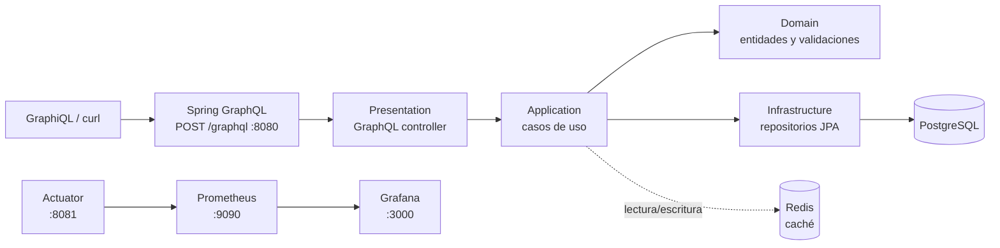

### Capas y modelo de datos

- **Domain:** contiene `Patient`, `Doctor`, `ClinicalHistory`, `Gender`, las
  reglas de validación y las excepciones del dominio.
- **Application:** contiene los casos de uso para registrar y consultar
  historias, aplicar paginación y gestionar el caché.
- **Infrastructure:** contiene JPA, Flyway, PostgreSQL, Redis, Micrometer y
  Actuator.
- **Presentation GraphQL:** expone las operaciones GraphQL, sus inputs,
  respuestas y errores.

Las relaciones principales son:

```text
Patient 1 ------ N ClinicalHistory N ------ 1 Doctor
```

La estructura física se crea con
`src/main/resources/db/migration/V1__create_clinical_history.sql`.

Este README concentra la descripción de capas, modelo, flujo y despliegue de
la solución.

### Flujo de una consulta

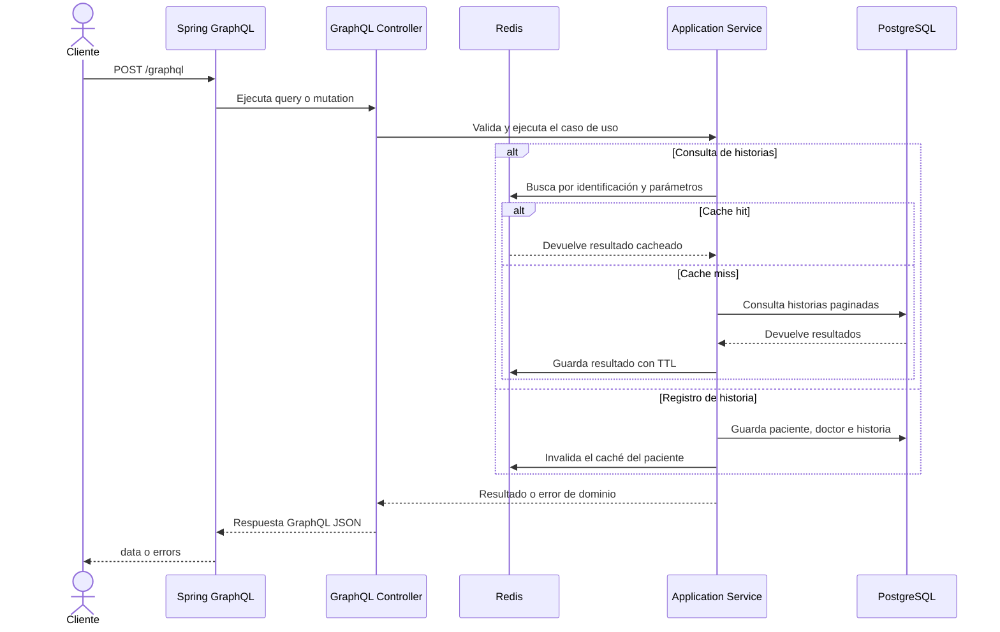

## API GraphQL

### Operaciones principales

| Operación | Propósito |
|---|---|
| `createClinicalHistory` | Registra una historia junto con paciente y doctor. |
| `clinicalHistoriesByIdentification` | Consulta historias por cédula. |

Endpoint GraphQL: `http://localhost:8080/graphql`<br>
GraphiQL: `http://localhost:8080/graphiql`

### Mutation de creación

```graphql
mutation {
  createClinicalHistory(
    input: {
      patient: {
        identification: "1000000001"
        firstName: "Ana"
        lastName: "Gomez"
        age: 30
        gender: FEMALE
      }
      doctor: {
        name: "Carlos Perez"
        professionalLicense: "MED-1001"
        specialty: "Medicina general"
      }
      history: {
        consultationReason: "Dolor de cabeza"
        diagnosis: "Cefalea tensional"
        treatment: "Reposo e hidratacion"
        date: "2026-11-27T14:00:00Z"
      }
    }
  ) {
    id
    patient { identification firstName lastName age gender }
    doctor { name professionalLicense specialty }
    consultationReason
    diagnosis
    treatment
    date
  }
}
```

### Query paginada

```graphql
query {
  clinicalHistoriesByIdentification(
    identification: "1000000001"
    first: 10
    after: null
  ) {
    nodes {
      id
      patient { identification firstName lastName age gender }
      doctor { name professionalLicense specialty }
      consultationReason
      diagnosis
      treatment
      date
    }
    pageInfo { hasNextPage endCursor }
  }
}
```

La paginación utiliza `first` y `after`. El límite máximo es de 50 registros
por página. Para solicitar la siguiente página se envía el `endCursor` recibido
en la respuesta anterior. Las fechas utilizan formato ISO-8601, por ejemplo
`2026-11-27T14:00:00Z`.

Las respuestas y los errores se devuelven en formato JSON. El esquema completo
se encuentra en `src/main/resources/graphql/schema.graphqls`.

### Validaciones y errores

La API valida la identificación, edad, género, campos obligatorios, existencia
del paciente, tamaño de página y cursor. Los errores se devuelven en el campo
`errors` de GraphQL:

```json
{
  "errors": [
    {
      "message": "No existe un paciente con cédula: 9999999999"
    }
  ],
  "data": null
}
```

### Ejecución con `curl`

```bash
curl -X POST http://localhost:8080/graphql \
  -H 'Content-Type: application/json' \
  -d '{
    "query": "query($identification: String!) { clinicalHistoriesByIdentification(identification: $identification) { nodes { id diagnosis date } pageInfo { hasNextPage endCursor } } }",
    "variables": { "identification": "1000000001" }
  }'
```

## Caché y observabilidad

Las consultas por identificación se almacenan temporalmente en Redis. La clave
incluye la identificación, `first` y `after`; al crear una historia se invalida
el caché asociado al paciente.

Las métricas principales son:

```text
graphql_requests_total
graphql_request_duration_seconds
redis_cache_hits_total
redis_cache_misses_total
```

Prometheus consulta `http://localhost:8081/actuator/prometheus` y Grafana usa
Prometheus como fuente de datos. El dashboard muestra peticiones GraphQL,
duración, errores, hits y misses de Redis, estado de la aplicación y peticiones
por segundo.

## Ejecución

    cp .env.example .env
    docker compose up -d --build

Servicios:

- GraphQL: http://localhost:8080/graphql
- GraphiQL: http://localhost:8080/graphiql
- Métricas: http://localhost:8081/actuator/prometheus
- Prometheus: http://localhost:9090
- Grafana: http://localhost:3000

| Componente | Puerto del contenedor | Puerto local predeterminado |
|---|---:|---:|
| Aplicación GraphQL | 8080 | 8080 |
| Actuator | 8081 | 8081 |
| PostgreSQL | 5432 | 5432 |
| Redis | 6379 | 6379 |
| Prometheus | 9090 | 9090 |
| Grafana | 3000 | 3000 |

Comandos útiles:

```bash
docker compose ps
docker compose logs -f app
docker compose down
```

Si el puerto local `5432` está ocupado, cada desarrollador puede utilizar una
configuración local para publicarlo en otro puerto. Esa modificación no debe
subirse al repositorio.

Toda la documentación del proyecto está centralizada en este README. Las
imágenes de evidencia se encuentran en `docs/evidence/`.

La consulta por cédula utiliza paginación por cursor mediante `first` y
`after`, con un máximo de 50 registros por página. Las respuestas se cachean
en Redis durante el TTL configurado y el caché se invalida al registrar una
nueva historia para el paciente.

## Pruebas

    .\mvnw clean verify

En Linux/Mac usar `./mvnw clean verify`. No hace falta levantar PostgreSQL ni Redis: las pruebas usan H2 en memoria.

- Flyway ejecuta `V1__create_clinical_history.sql`.
- Hibernate arranca con `spring.jpa.hibernate.ddl-auto=validate`, por lo que el contexto solo inicia si las entidades coinciden con el SQL de la migración.
- Se cubren registro y consulta paginada por cédula, reutilización de paciente/doctor, y validaciones de cédula, edad, género y campos obligatorios.
- También se cubren el contrato GraphQL, cursores, caché Redis, invalidación,
  métricas y errores de datos inválidos o cédula inexistente.

Código y configuración:

    src/test/java/com/grupo6/clinicalhistory/ClinicalHistoryPersistenceTest.java
    src/test/resources/application.properties

Para ejecutar una sola prueba:

    .\mvnw test "-Dtest=ClinicalHistoryPersistenceTest#registraYConsultaHistoriaPorCedula"

Reportes generados:

- `target/surefire-reports/` — resultado de cada prueba.
- `target/site/jacoco/index.html` — cobertura.

## Estructura

    src/main/java/com/grupo6/
    ├── ClinicalHistoryApplication.java
    └── clinicalhistory/
        ├── domain/
        │   ├── Patient.java
        │   ├── Doctor.java
        │   ├── ClinicalHistory.java
        │   ├── Gender.java
        │   ├── exception/
        │   └── validation/
        ├── application/
        │   ├── RegisterClinicalHistoryService.java
        │   ├── FindClinicalHistoriesService.java
        │   ├── command/
        │   └── port/out/
        ├── infrastructure/
        │   └── persistence/          (repositorios JPA)
        └── presentation/graphql/     (queries, mutations y mapeo de respuestas)

    src/main/resources/
    ├── graphql/schema.graphqls
    └── db/migration/V1__create_clinical_history.sql

    src/test/
    ├── java/com/grupo6/clinicalhistory/
    │   ├── ClinicalHistoryPersistenceTest.java
    │   ├── GraphqlApiIntegrationTest.java
    │   ├── CursorPaginationTest.java
    │   ├── RedisClinicalHistoryQueryCacheTest.java
    │   └── GraphqlMetricsIntegrationTest.java
    └── resources/application.properties

## Evidencias de ejecución

Las evidencias se tomaron con datos ficticios y documentan el funcionamiento
de Docker, GraphiQL, paginación, Redis, Prometheus, Grafana y Maven.

| ID | Evidencia | Qué demuestra |
|---|---|---|
| E01 | Docker | Los cinco servicios están activos. |
| E02 | Mutation | Se registra una historia con paciente y doctor. |
| E03 | Query | Se consultan historias por cédula. |
| E04 | Paginación | La segunda página usa el `endCursor` de la primera. |
| E05 | Validación | GraphQL devuelve un error ante datos inválidos. |
| E06 | Redis cache miss | Una consulta no encontrada en caché incrementa el contador de misses. |
| E07 | Redis cache hit | La misma consulta reutiliza el resultado cacheado. |
| E08 | Invalidación | Crear una historia invalida el caché del paciente. |
| E09 | Prometheus | El target está activo y las métricas son consultables. |
| E10 | Grafana | El dashboard muestra métricas de la aplicación y Redis. |
| E11 | Pruebas | Maven termina con 29 pruebas exitosas. |

Para repetir las evidencias se debe ejecutar primero:

```bash
docker compose up -d --build
docker compose ps
```

En GraphiQL se ejecutan la mutation y la query anteriores con datos ficticios.
Para comprobar Redis, se consulta la misma combinación de cédula, `first` y
`after` dos veces: la primera debe producir un miss y la segunda un hit. Luego
se crea una nueva historia para comprobar la invalidación.

En Prometheus se verifica el target `clinical-history-api` en estado `UP` y se
consultan `graphql_requests_total`, `redis_cache_hits_total` y
`redis_cache_misses_total`. En Grafana se abre el dashboard `Clinical History
API` y se comprueba que tenga datos visibles.

La suite automatizada se ejecuta con `./mvnw clean verify` y debe terminar con
`Tests run: 29, Failures: 0, Errors: 0` y `BUILD SUCCESS`.

<details>
<summary>E01 — Contenedores Docker</summary>
<br>
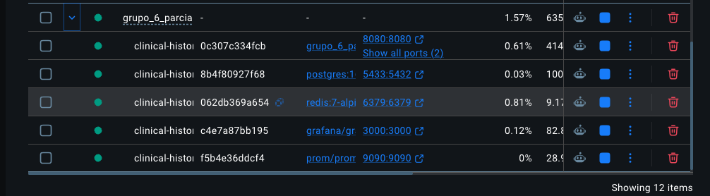
</details>

<details>
<summary>E02 — Mutation de creación</summary>
<br>
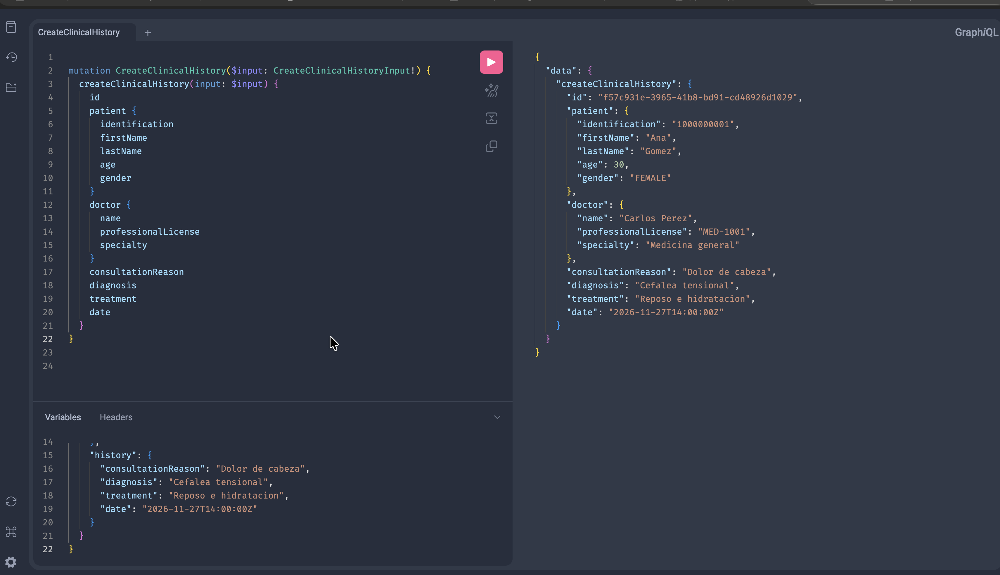
</details>

<details>
<summary>E03 — Query por identificación</summary>
<br>
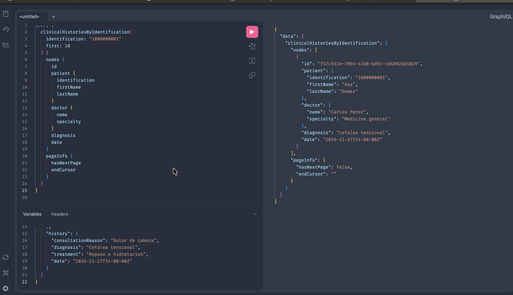
</details>

<details>
<summary>E04 — Paginación GraphQL</summary>
<br>
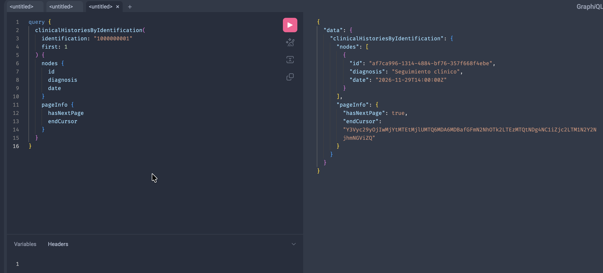
<br>
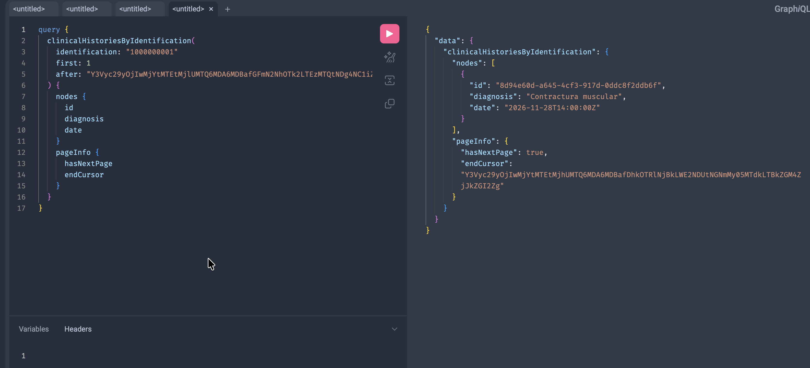
</details>

<details>
<summary>E05 — Validación de datos inválidos</summary>
<br>
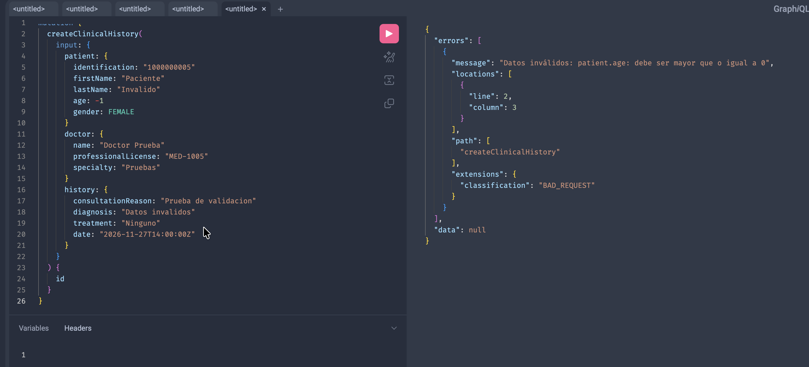
</details>

<details>
<summary>E06 — Redis cache miss</summary>
<br>
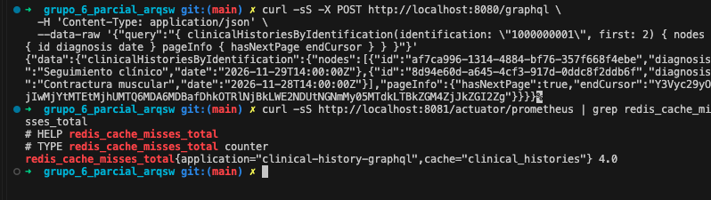
</details>

<details>
<summary>E07 — Redis cache hit</summary>
<br>
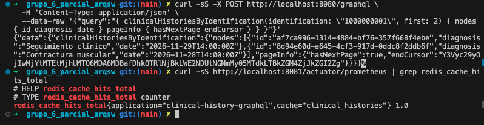
</details>

<details>
<summary>E08 — Invalidación de caché</summary>
<br>
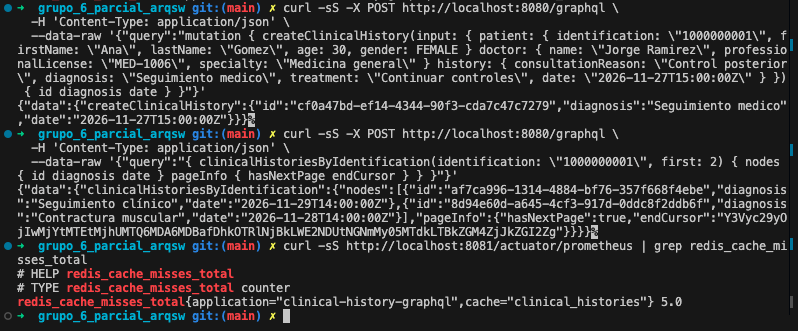
</details>

<details>
<summary>E09 — Prometheus</summary>
<br>
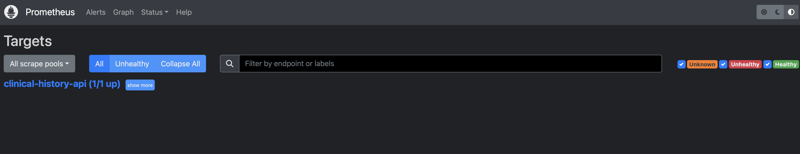
<br>
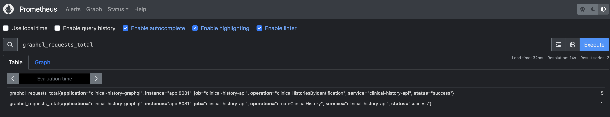
<br>
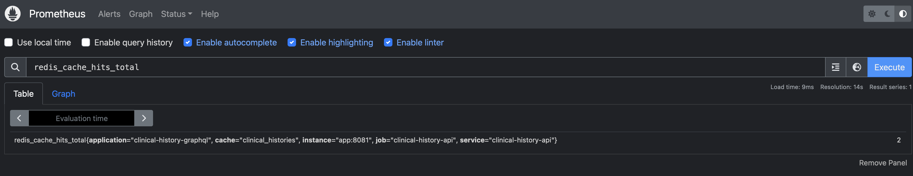
</details>

<details>
<summary>E10 — Grafana</summary>
<br>
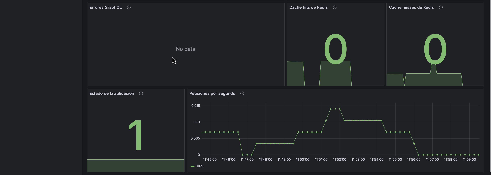
<br>
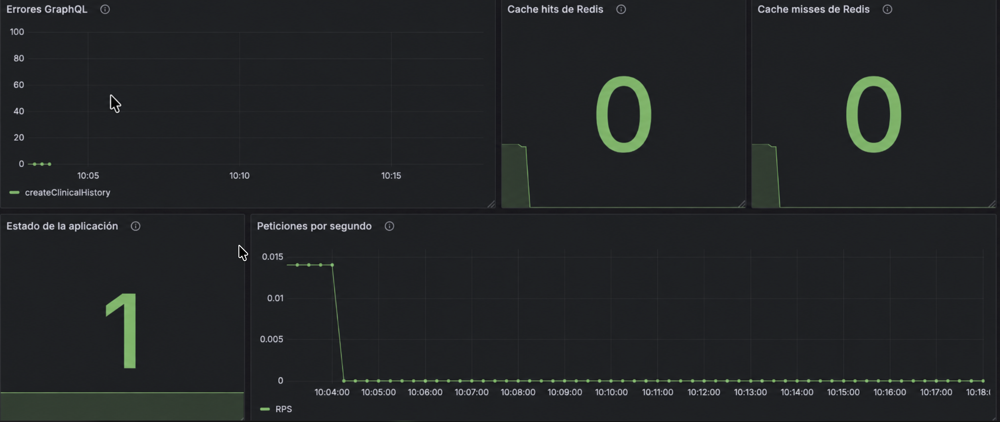
</details>

<details>
<summary>E11 — Pruebas automatizadas</summary>
<br>
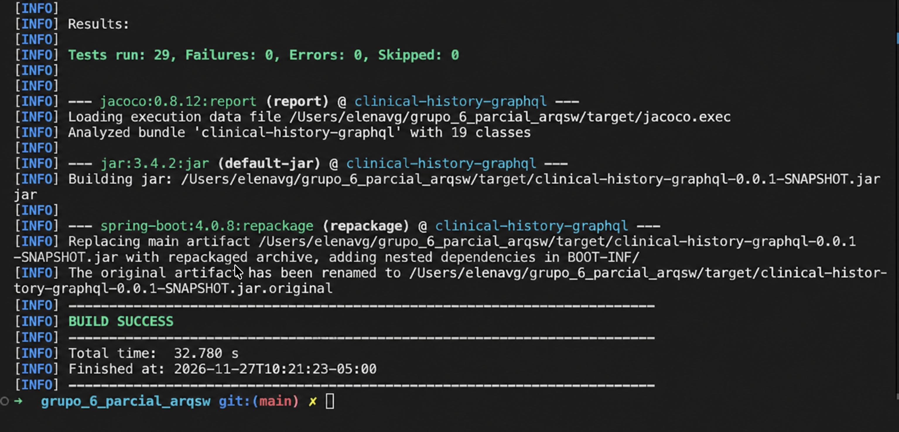
</details>
