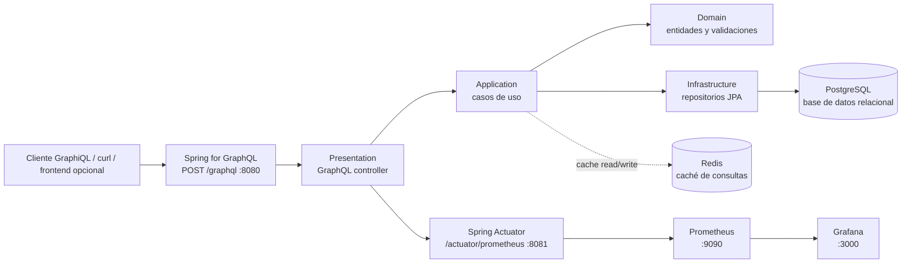
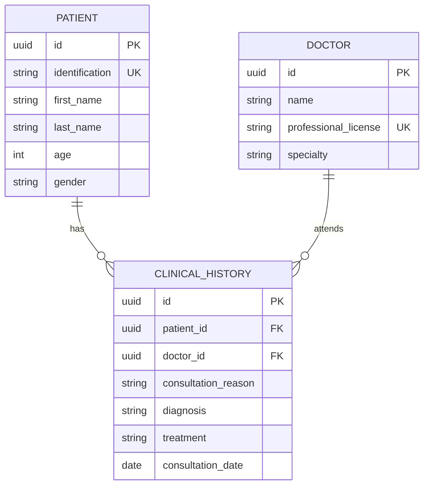
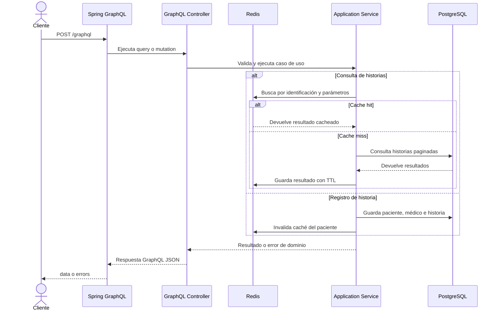
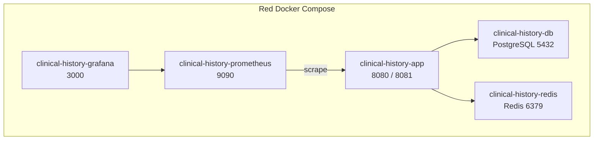

# Arquitectura de la solución

El proyecto implementa una API GraphQL para registrar y consultar historias
clínicas. La aplicación está organizada por capas y se ejecuta localmente como
un conjunto de contenedores Docker.

## Diagrama general



## Capas de la aplicación

### Domain

Contiene el modelo de negocio y sus reglas:

- `Patient`.
- `Doctor`.
- `ClinicalHistory`.
- `Gender`.
- Validaciones y excepciones del dominio.

Las relaciones principales son:

```text
Patient 1 ------ N ClinicalHistory N ------ 1 Doctor
```

### Application

Contiene los casos de uso de la aplicación:

- Registrar una historia clínica.
- Buscar historias clínicas por identificación del paciente.
- Validar datos de entrada.
- Aplicar paginación.
- Consultar e invalidar el caché Redis.

### Infrastructure

Contiene los adaptadores externos:

- Repositorios Spring Data JPA.
- Conexión con PostgreSQL.
- Migraciones Flyway.
- Integración con Redis.
- Métricas Micrometer y endpoint Actuator.

### Presentation GraphQL

Expone el contrato GraphQL y traduce las peticiones externas a casos de uso:

- Mutation `createClinicalHistory`.
- Query `clinicalHistoriesByIdentification`.
- Mapeo de inputs y respuestas.
- Manejo de errores de validación.
- Respuestas JSON mediante GraphQL.

## Modelo de datos



La estructura física se crea mediante la migración:

```text
src/main/resources/db/migration/V1__create_clinical_history.sql
```

## Flujo de una consulta GraphQL



## Observabilidad

La aplicación expone métricas en:

```text
http://localhost:8081/actuator/prometheus
```

Prometheus consulta periódicamente ese endpoint y Grafana utiliza Prometheus
como fuente de datos.

Las métricas funcionales esperadas son:

```text
graphql_requests_total
graphql_request_duration
redis_cache_hits_total
redis_cache_misses_total
```

Además, Actuator expone métricas HTTP y métricas de la JVM. La implementación
de las métricas específicas de GraphQL y Redis corresponde a la rama
`feature/03-cache-paginacion-observabilidad` y debe validarse antes de cerrar
la entrega.

## Despliegue local con Docker



Comandos principales:

```bash
docker compose up -d --build
docker compose ps
docker compose logs -f app
docker compose down
```

Puertos publicados:

| Componente | Puerto |
|---|---:|
| GraphQL / aplicación | `8080` |
| Actuator / Prometheus endpoint | `8081` |
| PostgreSQL | `5432` en el contenedor |
| Redis | `6379` |
| Prometheus | `9090` |
| Grafana | `3000` |

Si el puerto local `5432` está ocupado, puede utilizarse un archivo local
`docker-compose.override.yml` para publicar PostgreSQL en otro puerto. Ese
archivo es específico de cada desarrollador y no debe subirse al repositorio.

## Estructura principal del código

```text
src/main/java/com/bookly/backendcf/clinicalhistory/
├── domain/
├── application/
├── infrastructure/
└── presentation/graphql/

src/main/resources/
├── db/migration/
├── graphql/schema.graphqls
└── application.properties
```

## Referencias del proyecto

- Contrato GraphQL: `docs/GRAPHQL.md`.
- Evidencias de ejecución: `docs/EVIDENCE.md`.
- Migración de base de datos: `src/main/resources/db/migration/V1__create_clinical_history.sql`.
- Configuración Docker: `docker-compose.yml`.
